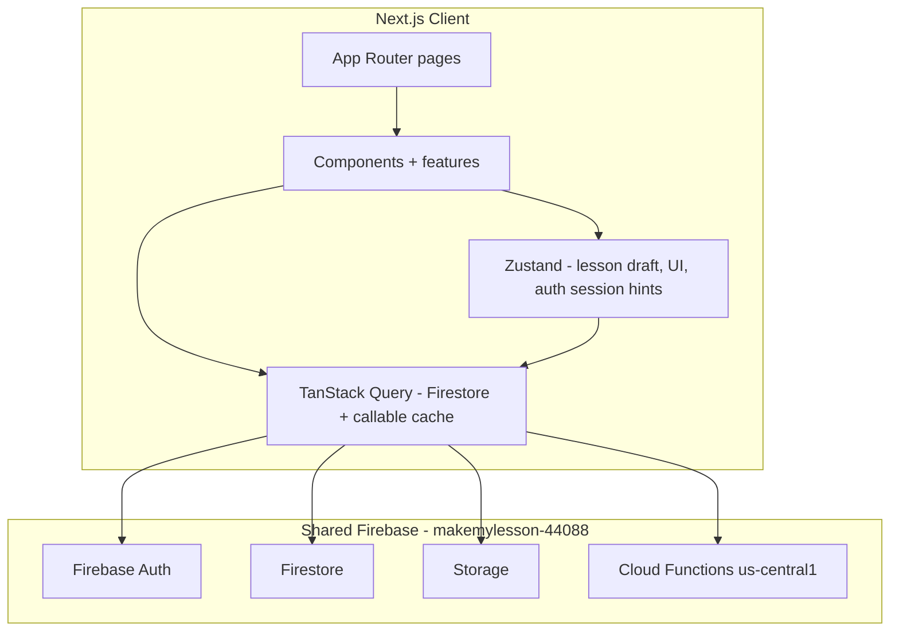

# Make My Lesson — Next.js Web App Architecture

## Purpose

Replace **Flutter Web** (`MakeMyLesson/`, legacy Firebase `/app/` paths) with a **Next.js App Router PWA** on **`https://makemylesson.ai`**, sharing Firebase project **`makemylesson-44088`** with Flutter **Android/iOS**. Public marketing lives on the **same host** (route group `(marketing)`). No schema migration, no duplicate databases.

See [firebase-structure.md](./firebase-structure.md#domain--url-strategy-decided) for URL rules.

## Repository layout (target)

```
nextjs/
  app/                 # Routes, layouts, metadata, PWA shell
  components/          # Shared UI (buttons, modals, tables, …)
  features/            # Feature modules (auth, library, stages, billing, …)
  hooks/
  services/            # Business orchestration (library, exports, …)
  firebase/            # config, auth, firestore, storage, functions clients
  lib/                 # Utilities, constants
  store/               # Zustand stores
  types/               # TypeScript models (parity with Dart)
  utils/
  styles/
  public/              # Icons, manifest assets
  docs/                # This documentation set
```

## Flutter source of truth

| Concern | Flutter location |
|--------|-------------------|
| Routing | `lib/router/app_router.dart` (go_router) |
| Global state | `lib/providers/*` (Riverpod) |
| Firebase | `lib/firebase_options.dart`, repositories, `lib/services/*` |
| UI shell | `lib/widgets/navigation/main_app_nav_shell.dart` |
| Theme | `lib/theme/app_theme.dart`, `app_colors.dart`, `app_text_styles.dart` |
| Backend | `MakeMyLesson/functions/` (Cloud Functions, `us-central1`) |
| Rules | `firestore.rules`, `storage.rules` |

## High-level architecture (Next.js)



### State management choice

**Zustand** for:

- `LessonDraft` equivalent (large multi-stage wizard state, polling job IDs)
- Desktop sidebar width, ephemeral UI
- Auth “effective session” hints (mirror `effectiveAuthStateProvider`)

**TanStack Query** for:

- Firestore snapshots (`users/{uid}/libraryItems`, notifications)
- Callable function mutations (generation, PayPal, org seats)
- Profile/subscription hydration

**React Context** only if needed for theme/auth provider wiring; keep stores thin.

### Server vs client components

| Use Server Components | Use Client Components |
|----------------------|------------------------|
| Marketing-adjacent static shells, legal links | All Firebase Auth, Firestore listeners |
| SEO metadata wrappers | Stage editors, file uploads, PayPal redirect |
| `robots.txt`, sitemap generation | PWA service worker (next-pwa) |

Firebase JS SDK runs **client-side** (and optionally Admin only if ever added server-side — not required for parity).

## Navigation model

Flutter uses **path-based** routing with `usePathUrlStrategy()` on web. Initial route on web is `/` (`LandingScreen`), not mobile splash/onboarding.

**Web-specific redirects** (`app_router.dart`):

- `/onboarding` → `/` (web skips onboarding carousel)
- PayPal return query `paypal_sub_done=1` or `paypal_cancel=1` → `/subscription` with query preserved
- `/ayla-chat` alias → `/ayla`

**Main app chrome** (`MainAppNavShell`):

- Tabs: Home (`/`), Ayla (`/ayla`), Library (`/library`), Profile (`/profile`), Notifications (`/notifications`)
- Desktop web: top-right tab bar; mobile: floating bottom nav
- Web “Home” tab opens the marketing landing at `/` on the same host (`makemylesson.ai`)

Stage routes (`/stage1`–`/stage4`) use the shell but are not tab roots.

## Auth architecture

1. **Firebase Auth** session persistence (browser local persistence).
2. **Post-auth routing** (`post_auth_navigation.dart`):
   - `banned` on `users/{uid}` → sign out + sign-in with reason query
   - `profileComplete == false` → `/auth/complete-profile`
   - Else → landing or stage return route
3. **Deferred setup**: `ensureUserDocument`, org membership sync, profile prefs merge.
4. **No phone authentication** in the Flutter app.

Social sign-in on web:

- Google: `signInWithPopup(GoogleAuthProvider)` (not `google_sign_in` package)
- Apple: `signInWithPopup(AppleAuthProvider)`

Email/password signup uses **Cloud Functions OTP** (`startEmailSignupVerification` → `completeEmailSignup` → `signInWithCustomToken`), not bare `createUserWithEmailAndPassword` for the full flow.

## Lesson creation pipeline (Stages 1–4)

Central state: `lesson_flow_provider.dart` / `LessonDraft`.

1. **Stage 1** — Curriculum selection + AI lesson plan (`generateStage1LessonPlan`, poll `getStage1GenerationStatus`). Job docs: `users/{uid}/stage1GenerationJobs/{jobId}`.
2. **Stage 2** — Presentation slides + optional images (`generateStage2Presentation`, `startStage2ImageJobs`, `getStage2GenerationStatus`, `retryStage2Image`). Images in Storage: `users/{uid}/stage2/{jobId}/slide_{n}.png|jpg`.
3. **Stage 3** — Formative assessment (`generateStage3Assessment`, `getStage3GenerationStatus`).
4. **Stage 4** — Summative assessment (`generateStage4Assessment`, `getStage4GenerationStatus`).

Credits deducted server-side after successful generation (`deductGenerationCreditAfterSuccess` in functions).

Library persistence: `users/{uid}/libraryItems/{itemId}` via `LibraryCatalogService`.

## Billing

| Platform | Mechanism |
|----------|-----------|
| iOS/Android | `in_app_purchase` + server validation (not used on web) |
| **Web** | **PayPal** via `createPayPalAccessOrder`, `finalizePayPalAccessOrder`, `getMmlWebPricingQuote` |
| Org plans | `createOrganizationSubscription`, seat management callables |

PayPal checkout return/cancel URLs: `https://makemylesson.ai/subscription?...` (see `PayPalWebCheckoutService` — replace legacy `/app/subscription` prefix).

## Notifications

- **In-app inbox**: Firestore `users/{uid}/notifications` + counters `users/{uid}/meta/notificationCounters`
- **FCM**: Mobile push via `firebase_messaging` + `users/{uid}/devices/{deviceId}`; web may use FCM for PWA with permission UX
- **Lifecycle events**: Client calls `sendUserNotification`; scheduled `evaluateNotificationLifecycle` on server

## Exports

Client-side PDF/DOCX/PPTX generation in Flutter (`document_export_core_service`, stage export services, `printing`, `syncfusion_flutter_pdf`). Next.js should replicate download/share flows using web-compatible libraries (e.g. pdf-lib, docx, pptxgenjs or server-assisted export if needed).

## Performance strategy

- Route-based code splitting per stage and auth
- Dynamic import for heavy editors (Stage 2 canvas, PDF export)
- `next/image` for logos and slide thumbnails (Firebase Storage URLs)
- Memoize slide lists and library grids
- Debounced Stage 1 local persist (mirror Flutter debounce)

## Accessibility & responsive

- WCAG: semantic landmarks, focus traps in modals, ARIA on tab nav
- Breakpoints: mirror `responsive_helper.dart` (~1200px desktop sidebar)
- Desktop: widen tables, sidebars for tips (`stage_tips_sidebar`), multi-column library grid

## Deployment note

- **Production domain:** `makemylesson.ai` — Next.js at **root** (`basePath` not used); marketing and app share this host.
- **Hosting provider:** **Hostinger VPS** — nginx + **PM2** + Next.js **`output: 'standalone'`** on port 3000. Firebase remains **backend only**.
- **Legacy domains:** `makemylesson.app` and `makemylesson.com` 301 redirect to `makemylesson.ai`.
- **Cutover:** Redirect legacy `/app/*` and decommission Flutter web on Firebase Hosting when Hostinger is live.
- **SEO:** Canonical / Open Graph use `makemylesson.ai`; the legacy domains must redirect rather than serve duplicates.

See [firebase-structure.md](./firebase-structure.md#production-hosting--hostinger-vps-decided).

## Environment

- Firebase web app: create **new** Web App in console; use env vars `NEXT_PUBLIC_FIREBASE_*` (do not commit secrets unnecessarily; apiKey is public by design).
- Functions region: **`us-central1`** (all `FirebaseFunctions.instanceFor(region: 'us-central1')` in Dart).
