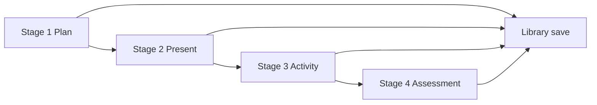

# User Flows

Flows derived from Flutter screens, providers, and Cloud Functions. Web-specific behavior is called out.

## Guest / anonymous

- User can browse **landing** (`/`), view marketing CTAs, open **Ayla** FAQ chat (callable requires auth — verify `callAylaSupport` rules; client still allows UI with error handling).
- **Stage generation** prompts sign-in (`stage_generation_sign_in_dialog.dart`) when credits/auth required.
- Local “session” concepts (`AuthSessionStorage`, guest library cache) exist on mobile; web defers much to Firebase Auth state.

## Email sign-up

1. `/auth/sign-up` — collect first/last name, email, password, confirm password, optional school name, optional school logo, DOB or age confirmation.
2. Validation (`sign_up_screen.dart`):
   - Required names, email format, password rules (match Flutter validators)
   - DOB: if set, age ≥ **16** (`ProfileRequirements.minimumAgeYears`)
   - Age confirmation checkbox when DOB not used
3. `startEmailSignupVerification(email)` → navigate `/auth/verify-otp` with `OtpFlowType.signupVerification` + `PendingSignupDraft`.
4. User enters OTP → `completeEmailSignup` with `profileDraft` → receive `customToken` → `signInWithCustomToken`.
5. `navigateAfterFirebaseSignIn` → complete profile if needed → landing.
6. Optional: `sendWelcomeEmail` for social-created accounts.

## Email sign-in

1. `/auth/sign-in` — email + password.
2. Firebase `signInWithEmailAndPassword`.
3. If email not verified path uses OTP flow in some branches — check `sign_in_screen.dart` for verification redirects.
4. Post-auth: banned check, profile complete, `deferredPostAuthSetup`.

## Google / Apple sign-in

- **Web:** Firebase popup providers (Google, Apple).
- After success: `ensureUserDocument`, profile completion gate, org membership `ensureOrganizationMembershipForCurrentUser`.

## Forgot / reset password

1. `/auth/forgot-password` → `sendPasswordReset({ email })` (Cloud Function, not only `sendPasswordResetEmail`).
2. User receives email with link containing `oobCode`.
3. `/auth/reset-password?oobCode=...` → Firebase `confirmPasswordReset` (see `reset_password_screen.dart`).

## Complete profile

1. `/auth/complete-profile` when `profileComplete != true`.
2. School name (optional), DOB or age confirm, optional logo upload → `UserProfileRepository.saveCompletedProfile` + Storage upload.
3. Redirect to `/`.

## Sign-out / delete account

- Sign-out: clear local prefs, Firebase `signOut`, Google sign-out on mobile only.
- Delete: `deleteMyAccount` callable (`account_security_service.dart`).

## Email change (profile)

1. `startEmailChangeVerification`
2. OTP screen / verification
3. `completeEmailChangeVerification`

## Subscription (web)

1. `/subscription` or `/pricing` (same screen).
2. Plans: free display + PayPal for `individual_monthly`, `individual_annual`, `credit_topup_50`, org `department` / `school` / `school_plus`.
3. `_startWebPayPalCheckout` → `createPayPalAccessOrder` → redirect to PayPal → return URL `https://makemylesson.ai/subscription?paypal_sub_done=1&plan=...` (Flutter legacy used `/app/subscription` on the same host).
4. `finalizePayPalAccessOrder(orderId)` on return.
5. Org purchase → redirect to `/organization-dashboard?orgId=...`.

**Mobile:** In-app purchase flow (`purchase_provider`) — **not** implemented on Next.js except showing “use app store” where appropriate.

## Organization admin

1. Owner opens `/organization-dashboard?orgId=`.
2. Load `getOrganizationDashboardWithRenewal` (renewal callable for owner).
3. Add/remove teacher emails → `manageOrganizationSeat` (`add` / `remove`).
4. Firestore org docs are read-only from client; all mutations via functions.

## Lesson creation (happy path)

1. **Stage 1** (`/stage1`): Pick curriculum (catalog from `stage1_curriculum_catalog` / `CurriculumService`), topic, method, duration → generate plan → edit → save to library / continue.
2. **Stage 2** (`/stage2`): Source from Stage 1 library or upload → generate presentation → poll images → edit slides → export PPTX/PDF.
3. **Stage 3** (`/stage3`): Source from Stage 2 or upload → formative type (quick check, worksheet, exit ticket) → generate → edit.
4. **Stage 4** (`/stage4`): Source from Stage 3 or upload → summative type, duration, marks → generate quiz/test.

`planBundleId` links related library rows; **complete pack** when all four stages saved (`completePackStages == 15` in library tab).

## Library

1. `/library` — tabs: Lesson Plans, Presentations, Activities, Assessments, Complete Packs, Favourites.
2. Search filters topic, subject, curriculum route.
3. Tap item → `/library/review` with item payload (Flutter passes `extra`; Next.js should use id + fetch or state).
4. From review: jump to stage editors, favourite toggle, export, share, delete.

## Ayla assistant

1. `/ayla` full-screen chat **or** embedded `AylaAssistant` on stage screens.
2. Messages → `callAylaSupport` with FAQ text + history.
3. FAQ source: `lib/data/ayla_faq_data.dart` (bundle static JSON in Next.js).

## Notifications

1. `/notifications` — list from Firestore snapshot.
2. Mark read / delete / clear all via callables.
3. Deep links from `deepLink` field → router navigation.
4. Unread badge on nav shell (`unreadNotificationCountProvider`).

## Engagement prompts

`engagement_prompt_coordinator.dart` + `rate_us_dialog` — trigger after milestones; web may use softer prompts (no `in_app_review`).

## Web vs mobile entry

| Mobile | Web (Next.js) |
|--------|----------------|
| `/splash` → onboarding or landing | `/` landing directly |
| Onboarding carousel | Redirect onboarding → `/` |
| Bottom nav | Bottom nav & desktop top tabs |
| Home tab → in-app landing | Home tab → `/` (marketing landing, same host) |

## Role-based access

| Role | Capabilities |
|------|----------------|
| Authenticated teacher | Own `users/{uid}` data, library, generation |
| Org `teacher` member | Read org doc (rules) |
| Org `admin` / `owner` | Read members, invites, teacherUsage; dashboard UI |
| Banned user | Blocked at auth routing |

No separate “super admin” app UI in Flutter client.
